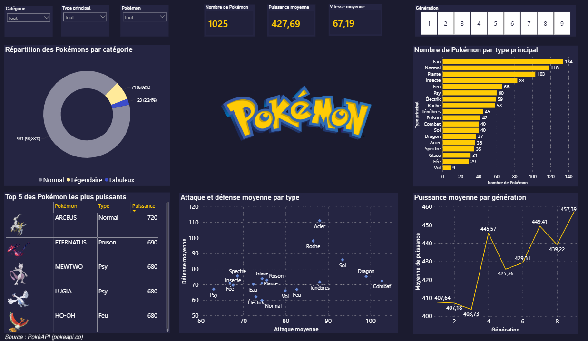

# Dashboard Power BI : l'univers Pokémon

## Présentation

Ce dashboard interactif présente les 1025 Pokémon à partir de leurs statistiques de base. La puissance d'un Pokémon est la somme de ses six statistiques : PV, attaque, défense, attaque spéciale, défense spéciale et vitesse.

## Ce que montre chaque visuel

Quatre filtres en haut de la page permettent de choisir une catégorie, un type principal, un Pokémon (avec une recherche par nom) ou une génération de 1 à 9. Quand on en sélectionne un, les autres visuels se mettent à jour.

Les trois cartes donnent les chiffres clés : 1025 Pokémon, une puissance moyenne de 427,69 et une vitesse moyenne de 67,19.

Le graphique en anneau montre la répartition par catégorie. La grande majorité des Pokémon sont normaux (90,83 %), contre 71 légendaires et 23 fabuleux.

Le graphique en barres compte les Pokémon par type principal. L'eau domine avec 134 Pokémon et le type vol est le plus rare avec 9.

Le tableau classe les 5 Pokémon les plus puissants. Arceus arrive en tête avec 720, devant Éternatus (690) puis Mewtwo, Lugia et Ho-Oh (680).

Le nuage de points compare les types entre eux. Chaque point est un type, ce qui permet de repérer ceux qui sont plutôt offensifs, défensifs ou équilibrés.

La courbe montre la puissance moyenne par génération. Elle passe de 407,64 à la première génération à 457,39 à la neuvième, avec un saut net à la quatrième.

## Outil et sources

Le dashboard a été réalisé avec Power BI.

Les données viennent de [PokéAPI](https://pokeapi.co) et les images de [PokéAPI Sprites](https://github.com/PokeAPI/sprites).
