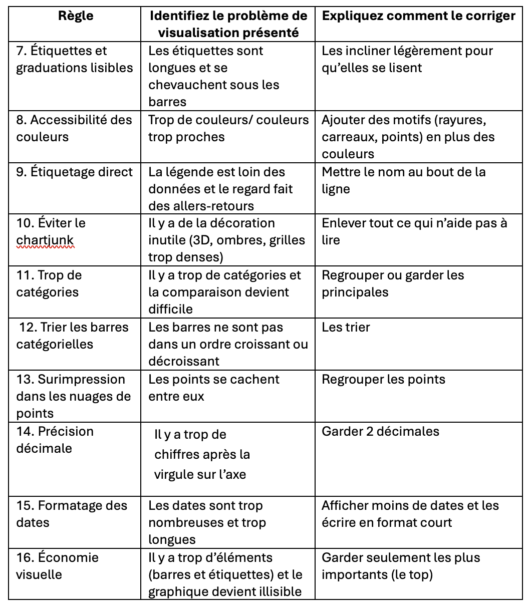
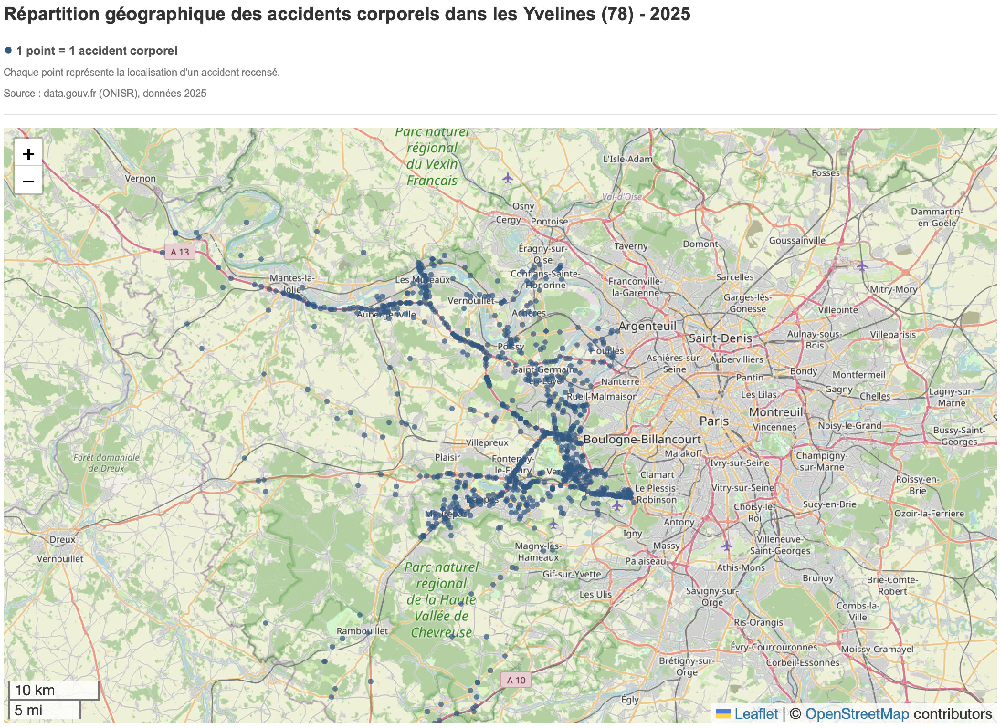
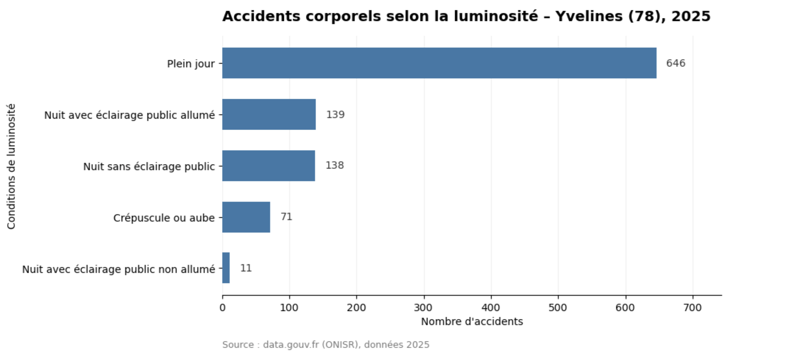

## Partie 1 – Lisibilité des visualisations

Ce tableau a été réalisé sur Word

## Partie 2 – Cartographie des accidents routiers

### Graphique 1

La carte montre la répartition des accidents corporels dans les Yvelines en 2025. On observe une concentration des accidents autour des zones urbaines et des grands axes routiers. J'ai choisi une carte interactive avec Folium pour visualiser précisément leur localisation. Le fond OpenStreetMap permet de repérer les villes et les routes.

Règles de lisibilité appliquées :

- Règle 7 : Étiquettes et graduations lisibles
- Règle 8 : Accessibilité des couleurs
- Règle 10 : Éviter le chartjunk
- Règle 13 : Surimpression dans les nuages de points
- Règle 16 : Économie visuelle

### Graphique 2

En 2025 dans les Yvelines la majorité des accidents corporels (646 sur 1005) ont lieu en plein jour. Cela pourrait s'expliquer par plus de trafic en journée mais les données ne permettent pas de le confirmer. J'ai choisi un histogramme car il permet de comparer simplement le nombre d'accidents selon la luminosité.

Règles de lisibilité appliquées

- Règle 7 : Étiquettes et graduations lisibles
- Règle 8 : Accessibilité des couleurs
- Règle 10 : Éviter le chartjunk
- Règle 12 : Trier les barres catégorielles
- Règle 16 : Économie visuelle
